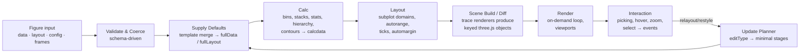

# Holochart Architecture

This is a summary of the architecture. The original design, with every epic and story, is in
[plan.md](plan.md) (sections 3 to 6). Decisions and their reasoning are recorded as ADRs in
[docs/adr/](docs/adr/); the index is at the end of this file.

Holochart is in alpha: `0.1.0-alpha.0` is on npm. Everything below describes code that exists
unless a row or sentence says "planned"; planned work is ordered in [backlogv2.md](backlogv2.md).

## Guiding principles

Summarized from [plan.md section 3](plan.md#3-guiding-principles):

1. **Schema is the source of truth.** Each attribute is declared once (type, default, validation,
   edit type, description); TS types, validators, defaults, and docs are generated from it.
   ([ADR-002](docs/adr/002-schema-first-attribute-dsl.md))
2. **Declarative first, imperative escape hatches always.** The JSON spec covers most needs;
   direct access to the three.js scene, materials, and render hooks covers the rest.
3. **Pure data pipeline, thin render layer.** Defaults, calc, and layout are pure functions,
   testable without a GPU. They are written so that they can move to a Web Worker; today they
   run on the main thread ([ADR-011](docs/adr/011-calc-in-web-worker.md)).
4. **Minimal recompute.** Every attribute declares an `editType`, so updates re-run only the
   stages they affect.
5. **One renderer, many viewports.** One WebGL context per figure; subplots are scissored
   viewports ([ADR-004](docs/adr/004-one-webgl-context-per-figure.md)). On a page with many
   figures, later ones share one context
   ([ADR-023](docs/adr/023-shared-renderer-context-budget.md)).
6. **GPU-native primitives.** Markers, lines, bars, and cells are instanced geometry with custom
   shaders, never one `Mesh` per data point (enforced by the `holochart/no-per-point-objects`
   lint rule).
7. **2D is a special case of 3D.** 2D subplots use a pixel-space orthographic camera, so the same
   primitives render in both modes.
   ([ADR-008](docs/adr/008-pixel-space-orthographic-2d-camera.md))
8. **Docs, examples, and tests are the same artifacts.** Every example is also a visual
   regression test and gallery thumbnail.
   ([ADR-018](docs/adr/018-visual-regression-harness.md))
9. **Progressive disclosure.** `newPlot(el, [{ x, y }])` works with no configuration.
10. **Accessible by default.** The canvas renders; a DOM mirror describes the chart for assistive
    technology. ([ADR-005](docs/adr/005-webgl-sdf-text-with-dom-mirror.md))

## Figure model

A figure is `{ data, layout, config, frames }`, following Plotly's semantics and attribute names
wherever reasonable ([ADR-001](docs/adr/001-figure-spec-plotly-semantics.md)). Functional style
accessors such as `(d, i) => color` are allowed but marked non-serializable, with a serializable
`styleRules` alternative ([ADR-012](docs/adr/012-functional-accessors-non-serializable.md)).

## Monorepo layout

See [plan.md section 4.1](plan.md#41-monorepo-layout). pnpm workspaces plus Turborepo; package
names are `@mk7s/holochart` and `@mk7s/holochart-*`
([ADR-017](docs/adr/017-mk7s-npm-scope.md)).

| Path                      | Purpose                                                                               | Status  |
| ------------------------- | ------------------------------------------------------------------------------------- | ------- |
| `packages/core`           | Figure model, schema, validation, defaults, scales, update planning                   | Exists  |
| `packages/render`         | three.js renderer, viewports, cameras, GPU primitives, text, picking                  | Exists  |
| `packages/runtime`        | `Chart`, the pipeline, the update API, events, registry, plugin contracts             | Exists  |
| `packages/components`     | Axes, legend, colorbar, annotations, shapes, modebar, sliders, menus                  | Exists  |
| `packages/traces-basic`   | scatter, bar, pie, table                                                              | Exists  |
| `packages/traces-stats`   | histogram, histogram2d(contour), box, violin, splom, parcoords, parcats               | Exists  |
| `packages/traces-sci`     | heatmap, contour, image, the polar subplot, scatterpolar, barpolar                    | Exists  |
| `packages/traces-finance` | ohlc, candlestick, waterfall, funnel, funnelarea, indicator                           | Exists  |
| `packages/traces-hier`    | sunburst, treemap, icicle, sankey                                                     | Exists  |
| `packages/traces-3d`      | The 3D scene, scatter3d, surface, mesh3d, cone, streamtube, volume, isosurface, bar3d | Exists  |
| `packages/traces-geo`     | The geo subplot, scattergeo, choropleth, the globe; not in the full bundle (ADR-026)  | Exists  |
| `packages/traces-graph`   | graph, graph3d, chord and their layouts; not in the full bundle (ADR-029)             | Exists  |
| `packages/themes`         | Templates, palettes, colorscales, font presets                                        | Exists  |
| `packages/express`        | High-level API (`hx.scatter(df, ...)`), faceting, frames, marginals                   | Exists  |
| `packages/locales`        | Locale modules (plotly.js's): UI strings, number and date formats                     | Exists  |
| `packages/holochart`      | Full bundle (registers and re-exports everything except geo and graph)                | Exists  |
| `packages/holochart-py`   | Python notebook bridge: an anywidget and a Plotly renderer; not on PyPI               | Exists  |
| `apps/sandbox`            | Vite dev sandbox with example picker and GPU stats                                    | Exists  |
| `apps/docs`               | Documentation site (VitePress)                                                        | Exists  |
| `examples/`               | Canonical examples (sandbox, docs, gallery, visual tests)                             | Exists  |
| `tools/schema-gen`        | Schema to TS types, JSON Schema, attribute reference docs                             | Exists  |
| `tools/gallery-gen`       | Playwright screenshot pipeline for thumbnails                                         | Exists  |
| `tools/api-report`        | API Extractor reports in `api-reports/`, gated in CI                                  | Exists  |
| `tools/bench`             | GPU benchmark, run by hand (`pnpm bench:gpu`); a CI harness is planned                | Exists  |
| `tools/geo-data`          | Builds the basemap data from Natural Earth (ADR-024)                                  | Exists  |
| Tile maps                 | `scattermap`, `choroplethmap`, `densitymap` over MapLibre (ADR-027)                   | Planned |
| Plotly importer           | Plotly figure importer and a runner for the plotly.js mock corpus                     | Planned |
| Framework wrappers        | React, Vue, Svelte, Angular and a web component                                       | Planned |
| Playground                | Live editor with shareable links                                                      | Planned |

`three` is a peer dependency of every package that touches it
([ADR-003](docs/adr/003-three-peer-dependency.md)).

## Rendering pipeline

See [plan.md section 4.2](plan.md#42-the-rendering-pipeline).

| Stage             | Pure?                                               | Owner                               |
| ----------------- | --------------------------------------------------- | ----------------------------------- |
| Validate & coerce | Yes                                                 | `core`                              |
| Supply defaults   | Yes                                                 | `core` + each trace module          |
| Calc              | Yes                                                 | each trace module, run by `runtime` |
| Layout            | Yes (text measurement uses a cached metrics oracle) | `runtime` (`layout.ts`)             |
| Scene build/diff  | No                                                  | `render` + each trace module        |
| Render            | No                                                  | `render`                            |

Every stage runs on the main thread. The pure stages are meant to move to a worker (ADR-011,
not accepted yet); the only worker today lays out graphs
([ADR-029](docs/adr/029-graph-traces.md)).

Related decisions:

- Frames render on demand, only when the scene is dirty; a continuous loop runs only during
  animation or interaction ([ADR-007](docs/adr/007-on-demand-rendering.md)).
- One WebGL context per figure, subplots as scissored viewports
  ([ADR-004](docs/adr/004-one-webgl-context-per-figure.md)). The first four figures on a page
  get a context each and later ones share one, as do image exports
  ([ADR-023](docs/adr/023-shared-renderer-context-budget.md)).
- WebGL 2 is required. There is no SVG, Canvas 2D or WebGPU path; without WebGL 2 a chart shows
  a note and `newPlot` rejects with `WebGLUnavailableError`.
- Text is SDF in WebGL (troika-three-text) with a hidden DOM mirror
  ([ADR-005](docs/adr/005-webgl-sdf-text-with-dom-mirror.md)). The text engine is loaded lazily on
  first text use; layout measures text synchronously without it.
- Production builds strip attribute `description` strings; a `development` export condition keeps
  them ([ADR-020](docs/adr/020-strip-schema-descriptions.md)).
- 2D hover uses CPU spatial indexes; 3D uses GPU ID picking
  ([ADR-010](docs/adr/010-cpu-spatial-hover-gpu-picking-3d.md)).
- Geo and graph traces live in packages the full bundle does not import
  ([ADR-026](docs/adr/026-geo-packages-and-bundles.md), [ADR-029](docs/adr/029-graph-traces.md)).

## Coordinate systems

See [plan.md section 4.3](plan.md#43-coordinate-systems).

| Space              | Description                                                      | Used by                              |
| ------------------ | ---------------------------------------------------------------- | ------------------------------------ |
| **Data**           | Raw values: numbers, dates (ms), categories (index)              | Traces, annotations with `xref: 'x'` |
| **Linearized**     | After the scale transform (log10, category to index, date to ms) | GPU vertex buffers                   |
| **Domain**         | 0 to 1 within a subplot's plotting area                          | `xref: 'x domain'`                   |
| **Paper**          | 0 to 1 within the whole figure's plot area (inside margins)      | Layout components, `xref: 'paper'`   |
| **Pixel / Screen** | CSS pixels from the container's top-left                         | Hover, picking, text layout          |
| **World (3D)**     | Scene units after `aspectmode` normalization                     | 3D scenes                            |

In 2D, one world unit equals one CSS pixel, so line widths and marker sizes are in pixels
([ADR-008](docs/adr/008-pixel-space-orthographic-2d-camera.md)).

**Precision rule (relative-to-center):** vertex buffers store values relative to a per-trace
origin, not absolute values. This keeps float32 precision for millisecond timestamps and large
offsets. Any new primitive or trace must follow it.

## Trace module contract

Every trace type is a module registered with the runtime's registry
([ADR-019](docs/adr/019-runtime-package.md)). `CoreTraceModule` in
`packages/core/src/registry/types.ts` holds the renderer-free part and `TraceModule` in
`packages/runtime/src/contracts.ts` adds the rest. Both are tagged `@experimental`: they can
change in any release until the plugin API is frozen (backlogv2 V2-B8).

| Member                                        | Role                                                          |
| --------------------------------------------- | ------------------------------------------------------------- |
| `type`, `categories`                          | Trace name (`'scatter'`) and capability flags (`'cartesian'`) |
| `schema`, `layoutSchema?`                     | Attribute schema: the single source of truth                  |
| `supplyDefaults`, `supplyLayoutDefaults?`     | Fill `fullData` and `fullLayout` from input and template      |
| `calc?`, `extremes?`                          | Pure and synchronous; produce calcdata and autorange extremes |
| `calcAppend?`, `extremesAppend?`              | Incremental versions for `extendTraces` (scatter only today)  |
| `crossTraceCalc?`, `crossTraceLayout?`        | Stacking and grouping across traces; shared domain layout     |
| `plot?`                                       | `TraceRenderer`: create, update and dispose GPU objects       |
| `hoverPoints?`, `selectPoints?`, `eventData?` | Hover and selection hit-testing, event payloads               |
| `keyboardPoints?`                             | Stops for keyboard navigation                                 |
| `legendIcon?`, `colorbar?`                    | Legend glyph and colorbar spec                                |
| `meta`                                        | Description, docs page, Plotly equivalent                     |

## Technology stack

See [plan.md section 5](plan.md#5-technology-stack).

| Concern         | Choice                                                                                                                                                                                            |
| --------------- | ------------------------------------------------------------------------------------------------------------------------------------------------------------------------------------------------- |
| Language        | TypeScript 6.0 strict, `.ts` import extensions, erasable syntax only ([ADR-013](docs/adr/013-ts-import-extensions-native-type-stripping.md))                                                      |
| Rendering       | three.js as a peer dependency ([ADR-003](docs/adr/003-three-peer-dependency.md))                                                                                                                  |
| Shaders         | GLSL3 via `ShaderMaterial` in `*.glsl.ts` modules; TSL for prototyping ([ADR-009](docs/adr/009-glsl3-shaders-tsl-prototyping.md), [ADR-014](docs/adr/014-glsl-as-typescript-template-modules.md)) |
| Text            | troika-three-text (SDF) ([ADR-005](docs/adr/005-webgl-sdf-text-with-dom-mirror.md))                                                                                                               |
| Math and data   | d3 micro-libraries ([ADR-006](docs/adr/006-d3-micro-libraries.md)), `earcut`, `flatbush`                                                                                                          |
| Build           | pnpm 11 workspaces + catalog, Turborepo, tsdown for JS, bundled `.d.ts`, and the IIFE CDN build ([ADR-015](docs/adr/015-tsup-js-tsc-declarations.md)), Vite 8 for apps                            |
| Dependencies    | pnpm `minimumReleaseAge` policy for new dependency versions ([ADR-016](docs/adr/016-pnpm-minimum-release-age.md))                                                                                 |
| Unit tests      | Vitest 5 + `fast-check`                                                                                                                                                                           |
| Visual tests    | Playwright 1.63, Chromium + SwiftShader, `pixelmatch` ([ADR-018](docs/adr/018-visual-regression-harness.md))                                                                                      |
| Lint and format | ESLint 10 flat config + Prettier 3                                                                                                                                                                |
| Docs            | VitePress, with the attribute reference from `tools/schema-gen` and the API reference from TypeDoc                                                                                                |
| Releases        | Changesets (one fixed version group), `size-limit` budgets, API Extractor reports                                                                                                                 |

## ADR index

The canonical index is [docs/adr/README.md](docs/adr/README.md). Start new ADRs from
[000-template.md](docs/adr/000-template.md).

- [ADR-001: Figure spec with Plotly semantics](docs/adr/001-figure-spec-plotly-semantics.md)
- [ADR-002: Schema-first attribute DSL](docs/adr/002-schema-first-attribute-dsl.md)
- [ADR-003: three as a peer dependency](docs/adr/003-three-peer-dependency.md)
- [ADR-004: One WebGL context per figure](docs/adr/004-one-webgl-context-per-figure.md)
- [ADR-005: WebGL SDF text with a DOM mirror](docs/adr/005-webgl-sdf-text-with-dom-mirror.md)
- [ADR-006: d3 micro-libraries](docs/adr/006-d3-micro-libraries.md)
- [ADR-007: On-demand rendering](docs/adr/007-on-demand-rendering.md)
- [ADR-008: Pixel-space orthographic 2D camera](docs/adr/008-pixel-space-orthographic-2d-camera.md)
- [ADR-009: GLSL3 shaders, TSL for prototyping](docs/adr/009-glsl3-shaders-tsl-prototyping.md)
- [ADR-010: CPU spatial hover, GPU picking for 3D](docs/adr/010-cpu-spatial-hover-gpu-picking-3d.md)
- [ADR-011: Calc in a Web Worker](docs/adr/011-calc-in-web-worker.md)
- [ADR-012: Functional accessors are non-serializable](docs/adr/012-functional-accessors-non-serializable.md)
- [ADR-013: `.ts` import extensions and native type stripping](docs/adr/013-ts-import-extensions-native-type-stripping.md)
- [ADR-014: GLSL as TypeScript template modules](docs/adr/014-glsl-as-typescript-template-modules.md)
- [ADR-015: tsdown for JS, bundled declarations, and the IIFE build](docs/adr/015-tsup-js-tsc-declarations.md)
- [ADR-016: pnpm minimum release age](docs/adr/016-pnpm-minimum-release-age.md)
- [ADR-017: The `@mk7s` npm scope](docs/adr/017-mk7s-npm-scope.md)
- [ADR-018: Visual regression harness](docs/adr/018-visual-regression-harness.md)
- [ADR-019: A runtime package owns charts, the pipeline and the plugin contracts](docs/adr/019-runtime-package.md)
- [ADR-020: Strip schema descriptions from production builds](docs/adr/020-strip-schema-descriptions.md)
- [ADR-021: A dark, dense default look](docs/adr/021-default-look.md)
- [ADR-022: Range breaks compress an axis' linear space](docs/adr/022-range-breaks-compressed-linear-space.md)
- [ADR-023: A shared renderer and a context budget](docs/adr/023-shared-renderer-context-budget.md)
- [ADR-024: Basemap data from Natural Earth](docs/adr/024-geo-basemap-data.md)
- [ADR-025: Geo projects on the CPU through d3-geo](docs/adr/025-geo-projection-pipeline.md)
- [ADR-026: Geo ships as add-on packages](docs/adr/026-geo-packages-and-bundles.md)
- [ADR-027: Tile maps use MapLibre GL](docs/adr/027-map-renderer-integration.md)
- [ADR-028: The 3D globe](docs/adr/028-geo-globe.md)
- [ADR-029: Network graphs](docs/adr/029-graph-traces.md)
